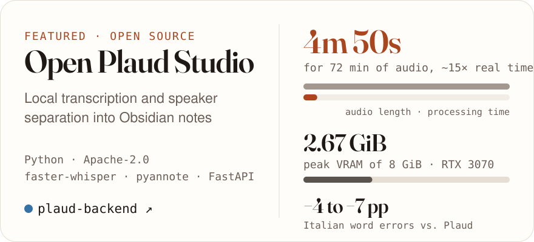
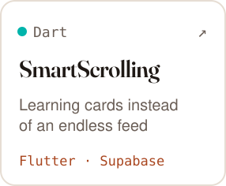
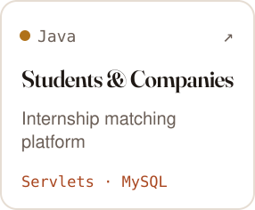
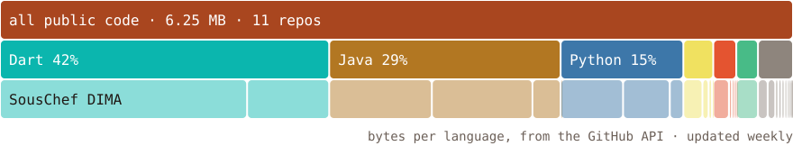

<!-- Generated by scripts/build_profile.py. Edit the script, not this file. -->

<picture><source media="(prefers-color-scheme: dark)" srcset="assets/hero-dark.svg"></picture>

I build systems end to end: firmware for wearables and smart glasses, AI models and agents that run on one local GPU, and the apps on top. At Politecnico di Milano I research machine learning, agentic pipelines, RAG and deep learning for holography.

[LinkedIn](https://www.linkedin.com/in/flavio-di-lorenzo-573043295/) · [plaud-backend](https://github.com/Frost40/plaud-backend) · [All repositories](https://github.com/Frost40?tab=repositories)

 

<picture><source media="(prefers-color-scheme: dark)" srcset="assets/station-work-dark.svg"></picture>

<picture><source media="(prefers-color-scheme: dark)" srcset="assets/bento-dark.svg"></picture>

 

<picture><source media="(prefers-color-scheme: dark)" srcset="assets/station-selected-dark.svg"></picture>

<a href="https://github.com/Frost40/plaud-backend"><picture><source media="(prefers-color-scheme: dark)" srcset="assets/spotlight-dark.svg"></picture></a>

<a href="https://github.com/Frost40/smart_scrolling"><picture><source media="(prefers-color-scheme: dark)" srcset="assets/card-smart_scrolling-dark.svg"></picture></a>
<a href="https://github.com/Frost40/Hypermedia_Polimi_24-25"><picture><source media="(prefers-color-scheme: dark)" srcset="assets/card-hypermedia_polimi_24-25-dark.svg"></picture></a>
<a href="https://github.com/Frost40/BarbieriDiLorenzo"><picture><source media="(prefers-color-scheme: dark)" srcset="assets/card-barbieridilorenzo-dark.svg"></picture></a>

 

<picture><source media="(prefers-color-scheme: dark)" srcset="assets/station-extras-dark.svg"></picture>

<picture><source media="(prefers-color-scheme: dark)" srcset="assets/git-graph-dark.svg"></picture>

<picture><source media="(prefers-color-scheme: dark)" srcset="assets/languages-dark.svg"></picture>

<strong>All 11 public repositories</strong> · synced weekly

| Repository | Language | About |
| :--- | :--- | :--- |
| [`SousChef_DIMA`](https://github.com/Frost40/SousChef_DIMA) | Dart | Order-ahead cooking app: Flutter, Firebase, Stripe |
| [`smart_scrolling`](https://github.com/Frost40/smart_scrolling) | Dart | Offline-first microlearning app |
| [`Hypermedia_Polimi_24-25`](https://github.com/Frost40/Hypermedia_Polimi_24-25) | Vue | Nuxt 3 wellness studio site |
| [`plaud-backend`](https://github.com/Frost40/plaud-backend) | Python | Local GPU transcription and diarization |
| [`BasicRolePlay_TelegramBot`](https://github.com/Frost40/BasicRolePlay_TelegramBot) | Python | Telegram role-play bot |
| [`BarbieriDiLorenzo`](https://github.com/Frost40/BarbieriDiLorenzo) | Java | Internship matching platform |
| [`Fake_News_Detector`](https://github.com/Frost40/Fake_News_Detector) | Jupyter Notebook | Fake news classification |
| [`Project_Reti-Logiche_2023`](https://github.com/Frost40/Project_Reti-Logiche_2023) | VHDL | Digital logic design in VHDL |
| [`TIW-project2024`](https://github.com/Frost40/TIW-project2024) | Java | Web Technologies course project |
| [`API_Project_21-22`](https://github.com/Frost40/API_Project_21-22) | C | Algorithms and data structures in C |
| [`project-IS23-AM06`](https://github.com/Frost40/project-IS23-AM06) | Java | Software Engineering course project |

<picture><source media="(prefers-color-scheme: dark)" srcset="assets/status-dark.svg"></picture>
